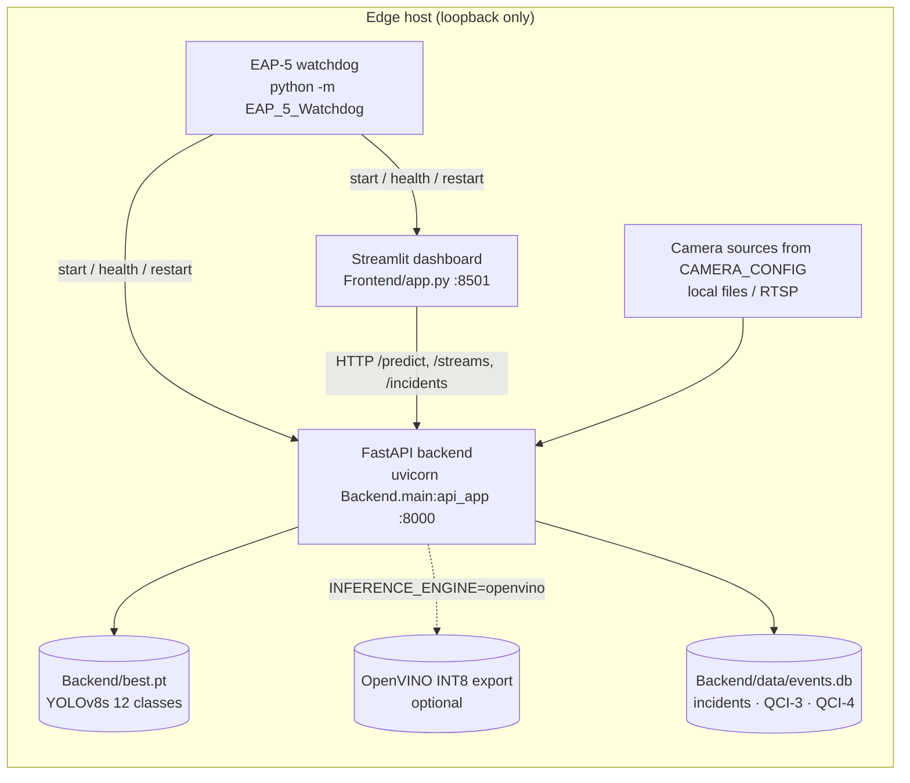

# IndustriX Production Runbook

Version 1.0.0 (FDD-3) · applies to the code at the FDD-3 branch (baseline `94d1a75`) ·
companion documents: [Deployment guide](DEPLOYMENT_GUIDE.md) · [Troubleshooting](TROUBLESHOOTING.md) ·
[Rollback & recovery](ROLLBACK_AND_RECOVERY.md) · [Handoff](DEPLOYMENT_HANDOFF.md) ·
[Hardware sizing](HARDWARE_SIZING_GUIDE.md) · [Hazard taxonomy](../specifications/HAZARD_TAXONOMY.md)

Commands marked **(validated)** were executed on 2026-10-22 on the reference host (Windows 11,
i5-7200U, full-stack interpreter `ESE_CPU1_Quantization/runtime/venv`); output is in `reports/fdd3/`.

## 1. System overview

| Service | Responsibility | Port | Health |
|---|---|---|---|
| Backend (`Backend/main.py`) | `/predict` image inference, `/streams/*` multi-camera processing (ByteTRACK, temporal confirmation, SED-2 escalation), `/incidents` audit + PDF export, `/qci3/*` quality alarms (QCI-3), `/edge/*` telemetry (QCI-4), `/alerts*` (SED-2), `/cameras*`, `/system/status` | 8000 | `GET /health` → 200 only when the model is loaded |
| Dashboard (`Frontend/app.py`) | operator console: live monitor, image inference, incidents | 8501 | `GET /_stcore/health` → `ok` |
| Watchdog (`EAP_5_Watchdog`) | launches both services, checks health every 10 s, restarts after 3 failures with backoff (max 5 restarts/h), stops only its own processes | — | `python -m EAP_5_Watchdog status` |

Startup order: the watchdog starts the backend, then the dashboard (the dashboard tolerates a backend
that is not yet ready and shows "backend unavailable"). The backend loads the model at startup; with
`INDUSTRIX_REQUIRE_MODEL=1` a missing or mismatched model stops startup instead of serving 503s.

Network: installation needs internet (pip, Docker base images). **Runtime is local**: no cloud inference,
model downloads disabled (`YOLO_OFFLINE=true`, `YOLO_AUTOINSTALL=false`), services bound to `127.0.0.1`,
QCI-4 cloud sync off by default. Camera sources may be RTSP on the local network.

## 2. Start and stop (watchdog-managed, recommended)
Working directory: repository root. Interpreter: one that has the full stack (see the deployment guide).
```powershell
$py = 'ESE_CPU1_Quantization/runtime/venv/Scripts/python.exe'   # or your venv's python
& $py -m FDD_3_Deployment_Handoff.validate_deployment --expect-ports-free   # preflight (validated: 24/24 PASS)
& $py -m EAP_5_Watchdog start                                              # background (validated)
& $py -m EAP_5_Watchdog status                                             # readiness: both 'healthy' (validated, 23 s)
& $py -m FDD_3_Deployment_Handoff.smoke_test                               # 6 live checks (validated: 6/6 PASS)
& $py -m EAP_5_Watchdog stop                                               # graceful (validated: 2 s, ports freed)
```
Expected `status` once ready:
```
backend    healthy      pid=<pid> failures=0 restarts_window=0 ...
dashboard  healthy      pid=<pid> failures=0 restarts_window=0 ...
```
The watchdog's real PID is the one printed by `status` (with a venv the `start` message may show the
launcher PID). Linux: `sh EAP_5_Watchdog/scripts/setup_watchdog.sh start|status|stop`.
Foreground (debugging): `& $py -m EAP_5_Watchdog run` and Ctrl+C.

Shutdown verification: `status` reports `running=False`; `GET http://127.0.0.1:8000/health` fails to
connect; the `watchdog.jsonl` tail shows `process_stopped ... graceful` for each service.
Never stop services by process name; use `stop` (it signals only processes the watchdog started).

### Manual start (without the watchdog)
```powershell
$env:INDUSTRIX_MODEL_PATH='Backend/best.pt'; $env:INDUSTRIX_REQUIRE_MODEL='1'; $env:YOLO_OFFLINE='true'
& $py -m uvicorn Backend.main:api_app --host 127.0.0.1 --port 8000
& $py -m streamlit run Frontend/app.py --server.address 127.0.0.1 --server.port 8501 --server.headless true
```
Stop with Ctrl+C in each console. Ready when `/health` returns `"model_loaded": true`.

### Container
See the deployment guide (EAP-3): `docker run -d --name industrix -p 127.0.0.1:8000:8000 -v industrix-data:/data industrix:eap3`;
stop with `docker stop industrix` (graceful, verified in EAP-3). The image contains the backend only.

## 3. Logs and records
| What | Where |
|---|---|
| Watchdog events (JSONL, rotated 5 MB × 4) | `EAP_5_Watchdog/runtime/watchdog.jsonl` |
| Current state | `EAP_5_Watchdog/runtime/status.json` |
| Service stdout/stderr (rotated each restart, 20 MB cap reported) | `EAP_5_Watchdog/runtime/logs/{backend,dashboard}.out.log` (+ `.1`) |
| Background launcher output | `EAP_5_Watchdog/runtime/watchdog.console.log` |
| Incidents, QCI-3 alarms, QCI-4 telemetry (SQLite) | `Backend/data/events.db` (`INCIDENT_DATABASE`), snapshots `data/snapshots` (`INCIDENT_SNAPSHOTS`); container: `/data` |
| SED-2 alert events | `SED_2_Alert_Escalation/runtime/alert_events.jsonl` |
| Generated incident PDFs | `reports/incidents/` |

## 4. Monitoring
| Signal | Source / how to inspect | Action when abnormal |
|---|---|---|
| Service availability | `python -m EAP_5_Watchdog status` | `unhealthy`/`recovering`: wait for the watchdog; `degraded`: see troubleshooting |
| Model readiness | `GET /health` (`model_loaded`, `model_sha256`, `classes`) | 503 → model missing/failed; see troubleshooting |
| Restart count / last restart reason | `status` (`restarts_window`, `total_restarts`, `last_restart`) and `watchdog.jsonl` | repeated restarts → inspect `logs/backend.out.log` |
| Inference errors and latency | not collected by the service; measure with `python -m EAP_4_Load_Test.run_load_test --profile smoke --target-url http://127.0.0.1:8000` | compare with the hardware sizing guide |
| Camera streams, FPS, skips, CPU/RSS | `GET /system/status` (telemetry), `GET /cameras` and `GET /cameras/{camera_id}/status` while streams run | stream errors: check sources in `CAMERA_CONFIG` |
| Edge telemetry (system/process CPU, process RSS, disk) | QCI-4 `GET /edge/status`, `GET /edge/history` | QCI-4 config has `minimum_disk_free_bytes` (default 100 MB); no CPU/memory alert thresholds: act on trends |
| Alerts | `GET /alerts`, `GET /alerts/active` (SED-2) | false-alert storms: see troubleshooting |
| Incidents | `GET /incidents` | export with `POST /incidents/{id}/export` |
| Disk space | `python -m FDD_3_Deployment_Handoff.validate_deployment` (`disk_free`) | keep ≥ 5 GB free (planning estimate) |
| Process memory | not alerted on; EAP-4 found slow private-bytes growth | restart during a maintenance window if RSS keeps rising; report |
Not available: per-request error/latency metrics inside the service, GPU metrics, alerting on memory or
disk, external monitoring integration. These are follow-up items.

## 5. Routine operations
- Daily: `status` (no `degraded`, low restart counts), check free disk, review `/alerts/active`.
- Before changes: back up `Backend/data/events.db` and configs (see rollback document).
- After any change: preflight, start, smoke test; for releases the FDD-1 gate
  (`python -m FDD_1_Release_Regression.run_release_gate`, about 11 minutes).
